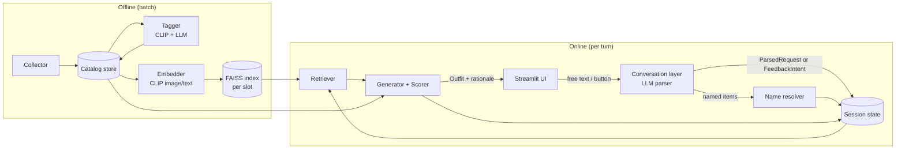

# AI Outfit Stylist: Technical Specification

| | |
|---|---|
| **Date** | October 19, 2026 |
| **Status** | Draft |
| **Companion doc** | [Product Requirements](PRD.md) |

This document describes *how* the system satisfies the requirements in the [PRD](PRD.md). Requirement IDs (e.g. `FR-GEN-4`) are cited inline so every design decision traces back to a product need.

---

## 1. Overview

The system has two phases:

1. **Offline (batch) phase.** Build the catalog, tag every item, and compute embeddings. This runs once, and again whenever the catalog changes.
2. **Online (interactive) phase.** Parse a user request, retrieve candidates for each slot, assemble and score outfits, show the best one, take feedback, update the session state, and repeat.

Splitting the work this way keeps expensive work (image embedding, tagging LLM calls) out of the request path, which is what makes the 5-second regeneration target (NFR-1) realistic on a laptop.

---

## 2. Architecture



### One request, end to end

Sam types *"build something around the Effortless Pant for brunch."*

1. The **conversation layer** sends the message, plus a compact summary of the session state, to the LLM, which returns a structured `ParsedRequest`: `vibes=[off-duty, polished]`, `occasion="brunch"`, `formality_target=2.5`, `named_items=["Effortless Pant"]`.
2. The **name resolver** fuzzy-matches "Effortless Pant" against catalog names, finds a clear top match, and adds it to `session.locked` in the `bottom` slot (FR-NAME-1, FR-FB-1).
3. The **retriever** builds a query embedding from the vibe and occasion text, blended with the session preference vector, and searches the FAISS index for each open slot (top, outerwear, shoes, accessory), filtering by season and formality range.
4. The **generator** forms candidate outfits from the top-k items per slot, always including the locked pant. The **scorer** ranks them on vibe coherence, formality match, and color harmony.
5. The best outfit, together with a short LLM-written rationale, is returned to the **UI**, and the turn is logged (NFR-6).

---

## 3. Tech Stack & Rationale

| Concern | Choice | Why this over the alternatives |
|---|---|---|
| Language | **Python 3.11+** | The ML ecosystem (PyTorch, FAISS, open_clip) is Python-first, and the UI framework is too. |
| Image/text embeddings | **open_clip** (ViT-B/32 to start; ViT-L/14 if accuracy needs it) | CLIP embeds images and text in one space, so a single embedding serves zero-shot tagging, text-to-image retrieval, and item-to-item similarity. open_clip has better-performing checkpoints (e.g. LAION-trained) than the original OpenAI release. |
| Vector search | **FAISS** (`IndexFlatIP`, one index per slot) | With hundreds or a few thousand items, exact search takes microseconds, so approximate indexes (IVF, HNSW) would add complexity for no gain. Separate indexes per slot make slot filtering free. FAISS also scales if the catalog grows (S-1). |
| LLM | **Claude** via the Anthropic Python SDK; defaults to `claude-sonnet-5-5`, configurable | Reliable structured output via tool use for request and intent parsing, and strong at reading fashion copy for tagging. The model is configurable so cost and latency can be tuned (NFR-2). |
| Fuzzy matching | **rapidfuzz** | Fast, MIT-licensed string similarity (`token_set_ratio`, `WRatio`) that tolerates word order, typos, and partial names, which is exactly what named-item resolution needs. |
| Catalog store | **SQLite** (items, tags) + **Parquet/NumPy** (embeddings) | Zero setup, a single file, queryable with SQL, easy to version. Embeddings stay in columnar or array form for fast loading. |
| Color analysis | **Pillow + scikit-learn** (k-means in CIELAB) | Extracts dominant colors from product images when the listed color name is missing or vague ("Heather Mocha"). |
| UI | **Streamlit** | The fastest way to get a chat-plus-image-grid interface with session state. A React frontend would add a week of work and no evaluation value. |
| Data validation | **Pydantic v2** | One schema definition serves LLM tool-use contracts, internal typing, and serialization. |
| Testing | **pytest** | Standard. |

---

## 4. Data Model

All schemas are Pydantic models. The SQLite tables mirror `Item` and `ItemTag`.

```python
Slot = Literal["top", "bottom", "dress", "outerwear", "shoes", "accessory"]
Season = Literal["spring", "summer", "fall", "winter"]
Vibe = Literal["cozy", "polished", "going-out", "off-duty",
               "athleisure", "minimal", "romantic", "edgy"]

class Item(BaseModel):                # FR-CAT-1, FR-CAT-2
    item_id: str                      # stable hash of product URL
    name: str                         # "Effortless Pant"
    brand_line: str                   # "Babaton"
    slot: Slot
    color_name: str | None            # as listed by retailer
    color_lab: tuple[float, float, float] | None   # dominant color, CIELAB
    fabric: str | None
    price_cad: float | None
    description: str
    image_path: str                   # local cache path
    product_url: str

class ItemTags(BaseModel):            # FR-TAG-1..4
    item_id: str
    seasons: list[Season]
    vibes: list[Vibe]                 # 1–3
    formality: int                    # 1–5
    confidence: dict[str, float]      # per-tag confidence
    source: dict[str, Literal["clip", "llm", "merged"]]
    needs_review: bool                # FR-TAG-5

class ParsedRequest(BaseModel):       # FR-REQ-2
    vibes: list[Vibe]
    occasion: str | None
    weather: Literal["hot", "warm", "mild", "cool", "cold", "rain", "snow"] | None
    season: Season | None
    formality_target: float | None    # 1.0–5.0
    required_slots: list[Slot]        # e.g. outerwear when cold
    named_items: list[str]            # raw strings, resolved later
    free_text_query: str              # condensed text for embedding

class FeedbackIntent(BaseModel):      # FR-FB-*
    action: Literal["swap", "lock", "unlock", "reject", "more_like",
                    "nudge", "named_swap", "accept", "new_request"]
    target_slot: Slot | None
    target_item: str | None           # name or item_id
    nudge: dict[str, float] | None    # e.g. {"formality": +1}, {"cozy": +0.5}

class Outfit(BaseModel):
    items: dict[Slot, str]            # slot -> item_id
    score: float
    score_breakdown: dict[str, float] # FR-GEN-3
    rationale: str                    # FR-GEN-5

class SessionState(BaseModel):        # FR-FB-6
    session_id: str
    request: ParsedRequest
    locked: dict[Slot, str]
    rejected: set[str]
    preference_vec: list[float]       # CLIP-space, unit norm
    formality_target: float
    vibe_weights: dict[Vibe, float]
    history: list[tuple[str, Outfit]] # (user message, outfit shown)
    turns: int
```

---

## 5. Pipelines

### 5.1 Data Collection (FR-CAT-1 to FR-CAT-5)

- **Source:** public Aritzia product listing and product detail pages.
- **Respecting terms (FR-CAT-4, NFR-4):** check `robots.txt` before crawling and skip any disallowed paths; wait at least 2 seconds between requests *(proposed)*; identify the crawler with a descriptive User-Agent; never fetch paths that require a login. Images are cached locally for processing and never re-hosted.
- **Extraction:** prefer structured data embedded in the page (JSON-LD `Product` schema) over HTML scraping, because it is more stable when the layout changes.
- **Slot assignment (FR-CAT-2):** map the retailer's category breadcrumb to a slot with a lookup table; items that don't map are routed to a manual review list.
- **Idempotency (FR-CAT-5):** `item_id = sha1(canonical_product_url)`, so re-runs upsert instead of inserting duplicates.
- **Fallback:** if automated collection isn't viable, use a hand-curated CSV of 150–300 items in the same schema. Everything downstream depends only on the catalog store, not on how the data got there.

### 5.2 Tagging (FR-TAG-1 to FR-TAG-6)

Two independent signals are produced, then merged.

**a) CLIP zero-shot on images.** Each label gets several prompt phrasings, whose text embeddings are averaged (prompt ensembling). This is noticeably more robust than a single prompt for abstract concepts.

```text
cozy:      "a photo of a cozy knit sweater", "soft warm comfortable clothing", ...
polished:  "a photo of tailored office clothing", "a polished professional outfit piece", ...
formality: one prompt set per level, scored as a softmax over 5 levels
```

For each item, take the cosine similarity between its image embedding and each label's mean text embedding, then softmax with a temperature over labels within each axis.
- Season and vibe: multi-label. Accept a label when its probability is at least τ *(proposed τ = 0.25, tuned on the validation set)*, keeping at most 3 vibes.
- Formality: the expected value over the 5 levels, rounded.

**b) LLM pass over the description.** Send the name, brand line, fabric, and description to Claude with a tool-use schema that returns `seasons`, `vibes`, `formality`, and a self-reported confidence. Fabric and copy (e.g. "brushed fleece", "silk satin") carry signals the image can miss.

**c) Merge rule.**

| Case | Result | `source` |
|---|---|---|
| Both agree | Accept; confidence = max of the two | `merged` |
| Only one source proposes the label, with high confidence | Accept | `clip` or `llm` |
| Conflict (e.g. formality differs by 2 or more) | Take the higher-confidence source and set `needs_review = True` | whichever won |

**d) Validation set (FR-TAG-6).** Hand-label 50 items stratified by slot *(proposed: about 8 per slot)*, before looking at model output, to avoid anchoring. Report per-axis accuracy separately for CLIP alone, the LLM alone, and the merged result. That three-way comparison is itself a useful result for the write-up.

### 5.3 Embeddings & Index

- **Item embedding:** `e_item = normalize(α·CLIP_image(img) + (1−α)·CLIP_text(name + description))`, with α = 0.7 *(proposed)*. Mostly visual, with the text helping to separate visually similar items.
- **Index:** one `faiss.IndexFlatIP` per slot over the unit-normalized `e_item`, so inner product equals cosine similarity.
- Embeddings are stored in `data/embeddings.npy` with an `item_id` order file, and versioned by the CLIP model name.

### 5.4 Retrieval (FR-GEN-1, FR-GEN-4)

For each open (unlocked) slot:

1. **Query vector:** `q = normalize(CLIP_text(request.free_text_query) + β·session.preference_vec)`, with β = 0.5 *(proposed)*. On the first turn, `preference_vec` is zero.
2. **Hard filters:** drop items in `session.rejected`, items whose season tags don't include the target season (when one is set), and items whose formality is more than 1 away from `formality_target` (relaxed to ±2 if fewer than k items survive).
3. **Search:** take the top k = 8 by cosine similarity *(proposed)*.

Slot logic:
- Choose the **dress path** (dress + shoes, plus outerwear and accessory) or the **separates path** (top + bottom + shoes, plus outerwear and accessory). Both are tried unless a locked item or the request forces one; the higher-scoring path wins.
- Outerwear is required when `weather ∈ {cool, cold, rain, snow}` or `"outerwear" ∈ required_slots` (FR-REQ-4); otherwise it is optional and only included if it raises the score.

### 5.5 Generation & Scoring (FR-GEN-1 to FR-GEN-6)

With k = 8 and at most 5 slots, full enumeration is 8⁵ ≈ 32K combinations, which is tractable but wasteful. Instead, use **beam search over slots** (beam width 20), filling the most constrained slot first (locked items, then bottom or dress, then top, outerwear, shoes, accessory).

**Score function:**

```text
score(outfit) = w_v · vibe_coherence
              + w_f · formality_match
              + w_c · color_harmony
              + w_q · query_relevance
              − w_r · repetition_penalty
```

| Term | Definition | Default weight *(proposed)* |
|---|---|---|
| `vibe_coherence` | Mean pairwise cosine similarity of item embeddings, plus overlap between the items' vibe tags and the target vibes | 0.30 |
| `formality_match` | `1 − mean(abs(item.formality − target)) / 4`, minus a penalty for a formality spread within the outfit greater than 2 | 0.25 |
| `color_harmony` | Rule-based score in CIELAB/HSV (see below) | 0.25 |
| `query_relevance` | Mean cosine similarity between each item and the query vector | 0.20 |
| `repetition_penalty` | 1 if the outfit is identical to the previous outfit (FR-GEN-6); a partial penalty for overlap with outfits shown more than one turn ago | 0.50 |

**Color harmony rules:**
- Treat as **neutrals** colors with chroma C* below 15 in LAB, plus a named set (black, white, grey, beige, camel, navy, denim). Neutrals go with everything.
- Among non-neutral colors, convert to hue angle and score pairs: analogous (Δhue < 30°) = 1.0, complementary (Δhue ≈ 180° ± 20°) = 0.9, triadic (≈ 120°) = 0.7, anything else = 0.3.
- Penalize more than 2 non-neutral color families in one outfit.
- `color_harmony` = mean pairwise score across the outfit.

Weights are tuned by hand on a small development set of requests, kept separate from the evaluation set. The learned scorer (S-2) would replace this function behind the same interface.

**Rationale (FR-GEN-5):** the chosen outfit, its score breakdown, and the request are sent to the LLM with instructions to write 1–3 sentences grounded in the actual items. The prompt includes only catalog facts, so the model can't invent details. To stay within NFR-2, this call is merged with the next turn's parse where possible, or generated with a smaller, faster model.

### 5.6 Feedback Loop (FR-FB-1 to FR-FB-7)

Each `FeedbackIntent` changes `SessionState` deterministically. This logic does not depend on the LLM, which is what makes it testable.

| Action | State change |
|---|---|
| `lock` | `locked[slot] = item_id` |
| `unlock` | `locked.pop(slot)` |
| `reject` | `rejected.add(item_id)`; `preference_vec ← normalize(preference_vec − γ·e_item)` |
| `swap` | Temporarily exclude the current item in that slot; regenerate only that slot, with the other slots locked for this turn (FR-FB-3), unless the best result for that slot drops the outfit score below a threshold, in which case allow a full regeneration |
| `named_swap` | Resolve the name (§5.7), then treat it as a `lock` in the resolved slot |
| `more_like` | `preference_vec ← normalize(preference_vec + δ·e_item)` |
| `nudge` | Formality: `formality_target += Δ` (clamped to 1–5). Vibe: `vibe_weights[v] += Δ`, and blend `CLIP_text(v)` into `preference_vec` |
| `accept` | End the session; write the summary and log (FR-STOP-1 to FR-STOP-3) |
| `new_request` | Re-parse the request; keep `rejected`; clear `locked` and `preference_vec` |

This is a **Rocchio-style relevance feedback** update in CLIP space: positive signals move the query toward liked items, and negative signals move it away. Proposed defaults are γ = 0.3 and δ = 0.4. Because the update accumulates across turns, the preference signal builds up instead of reacting only to the latest message (FR-FB-6).

UI buttons (FR-UI-3) produce `FeedbackIntent` objects directly and skip the LLM, so button and chat input go through the same code path (FR-FB-7).

### 5.7 Named-Item Resolution (FR-NAME-1 to FR-NAME-3)

1. **Normalize:** lowercase, strip "the", "Aritzia", and brand-line prefixes, and collapse whitespace.
2. **Candidates:** run `rapidfuzz.process.extract(query, catalog_names, scorer=WRatio, limit=5)`.
3. **Decide:**
   - If the top score is at least 85 and leads the second-best by at least 10 → resolve (FR-NAME-1).
   - If the top score is at least 85 but within 10 of the next → ask the user to choose among the top 3 (FR-NAME-2).
   - If the top score is below 85 → report no match and suggest the top 3 (FR-NAME-3).
4. **Slot hint:** if the user's text implies a slot (*"the Effortless pants"*), prefer candidates in that slot when breaking ties.

Thresholds are proposed values, to be tuned on the named-item test set.

### 5.8 Conversation Layer (FR-REQ-1 to FR-REQ-4)

- **One LLM call per user turn** classifies the message and extracts structure. It uses Claude tool use with two tools, `parse_request → ParsedRequest` and `parse_feedback → FeedbackIntent`, and the model picks the one that fits. The prompt includes a compact session summary (the current outfit's item names and slots, locked and rejected items) so references like *"the top"* or *"that coat"* can be resolved.
- **Validation:** tool output is validated with Pydantic. If validation fails, retry once with the error message attached; if it fails again, fall back to a keyword heuristic (e.g. "dressier" → formality +1) and ask the user to rephrase.
- **Vague requests (FR-REQ-3):** use default values (formality 3, season inferred from the current date, vibes `[minimal, off-duty]`) for any missing fields.
- **Call budget (NFR-2):** at most one parsing call and one rationale call per turn.

### 5.9 Interface (FR-UI-1 to FR-UI-4)

- **Layout:** a Streamlit two-column layout. The left column holds the chat (`st.chat_message` history plus `st.chat_input`), so earlier turns stay visible (FR-UI-2). The right column shows the current outfit as a grid of item cards (image, name, brand line, price) in a fixed slot order (FR-UI-1).
- **Card controls:** each card has 🔒 lock and ✕ reject buttons that produce a `FeedbackIntent` directly, without an LLM call (FR-UI-3, FR-FB-7).
- **State:** `SessionState` lives in `st.session_state`, and models and indexes are loaded once with `st.cache_resource`, so only the first request pays the model-loading cost (NFR-1).
- **Change highlighting (FR-UI-4):** compare the new outfit's `items` with the previous outfit's and draw a highlight border on slots that changed.
- **Final summary (FR-STOP-2):** on accept, replace the grid with a summary card that lists each piece with its product link, plus the total price.

---

## 6. Module Interfaces

```python
# catalog/
def ingest(source: Path | str) -> int                       # returns item count
def get_item(item_id: str) -> Item

# tagging/
def tag_items(items: list[Item]) -> list[ItemTags]
def evaluate_tags(gold: Path) -> TagReport

# retrieval/
def build_index(items: list[Item]) -> SlotIndex
def retrieve(slot: Slot, q: np.ndarray, filters: Filters, k: int = 8) -> list[str]

# scoring/
def score_outfit(outfit: dict[Slot, str], ctx: ScoreContext) -> tuple[float, dict]
def generate_outfit(state: SessionState) -> Outfit

# llm/
def parse_message(text: str, state: SessionState) -> ParsedRequest | FeedbackIntent
def write_rationale(outfit: Outfit, request: ParsedRequest) -> str

# session/
def resolve_item_name(text: str, slot_hint: Slot | None = None) -> Resolution
def apply_feedback(state: SessionState, intent: FeedbackIntent) -> SessionState
```

The scorer is accessed through `score_outfit`, so the learned compatibility model (S-2) can replace the rule-based scorer without touching anything else.

---

## 7. Evaluation Plan

| PRD metric | Method | Artifact |
|---|---|---|
| Tagging accuracy (G3) | Compare `ItemTags` with the 50-item gold set; report per-axis accuracy for CLIP, LLM, and merged | `eval/tagging_report.md` |
| Outfit coherence (G1) | Generate outfits for 30–50 held-out requests; 3 raters score each one blind (coherent yes/no, plus 1–5 ratings for color, formality, and vibe) against a written rubric; report majority-vote coherence and Fleiss' κ | `eval/rater_sheet.csv`, `eval/coherence_report.md` |
| Loop convergence (G2) | Run 20 or more sessions with scripted or real users against target outfit briefs; log turns until acceptance and the acceptance rate. Compare with an ablation that has **no preference vector** to show the feedback loop actually helps | `eval/sessions.jsonl`, `eval/loop_report.md` |
| Named-item resolution (G4) | 30–50 queries: exact names, typos, partial names, wrong-slot nouns, and names not in the catalog; report top-1 accuracy and how often ambiguous queries correctly trigger a choice prompt | `eval/names_test.csv` |
| Constraint violations (FR-GEN-4) | Automated assertions over every logged outfit | pytest + session logs |
| Latency (NFR-1) | Time each stage per turn; report p50 and p90 | `eval/latency.md` |

The **no-feedback ablation** for loop convergence matters most: it is what shows the refinement loop works, rather than just exists.

---

## 8. Proposed Repository Layout

```text
AritziasVeryOwn/
├── README.md
├── docs/
│   ├── PRD.md
│   └── TECH_SPEC.md
├── data/                    # gitignored: raw HTML, images, sqlite, embeddings
│   ├── catalog.sqlite
│   ├── images/
│   └── embeddings.npy
├── src/stylist/
│   ├── catalog/             # collection, parsing, slot mapping
│   ├── tagging/             # CLIP zero-shot, LLM tagger, merge
│   ├── retrieval/           # embeddings, FAISS index, filters
│   ├── scoring/             # color harmony, scorer, beam-search generator
│   ├── session/             # SessionState, apply_feedback, name resolver
│   ├── llm/                 # Claude client, prompts, tool schemas
│   └── ui/                  # Streamlit app
├── eval/                    # gold sets, scripts, reports
├── notebooks/               # exploration, prompt tuning
├── tests/
└── pyproject.toml
```

---

## 9. Stretch-Goal Designs

**S-1: Second brand.** Add a new collector that writes to the same `Item` schema, and re-run tagging unchanged. Measure tagging accuracy on a new 30-item gold set. A drop in accuracy shows how much the prompts are tuned to Aritzia's photography and copywriting style.

**S-2: Learned compatibility model.** Train a small MLP or transformer head on frozen CLIP embeddings, using Polyvore Outfits with the fill-in-the-blank and compatibility objectives. Plug it in behind `score_outfit` and compare it with the rule-based scorer on the same rater study (an A/B test with raters blind to which scorer produced each outfit).

**S-3: Persistent preferences.** Add a `users` table and persist `preference_vec`, `vibe_weights`, and long-term rejections across sessions, blending them into the new session's starting state with decay.

**S-4: Photo upload.** Embed the uploaded image with CLIP, classify its slot zero-shot, extract its dominant color, and insert it as a temporary `Item` that is locked in place. Everything else in the pipeline stays the same, because the system already works in CLIP space.

---

## 10. Risks & Mitigations (Technical)

| Risk | PRD link | Mitigation |
|---|---|---|
| CLIP zero-shot performs poorly on abstract vibes | G3 | Prompt ensembling; the LLM signal over descriptions; tune τ on validation data; fall back to a lightly fine-tuned linear probe on CLIP features trained on the gold set plus extra labels |
| Inconsistent product imagery (on a model vs. flat lay, background color) | G3, G1 | Prefer the flat-lay or first image; optionally crop with CLIP-guided center crop; report the effect in the evaluation |
| Beam search misses a good outfit | G1 | Widen the beam; compare against exhaustive enumeration on a sample to measure what is lost |
| LLM misreads references to items or slots | FR-FB-* | Include the current outfit in the prompt; buttons skip the LLM; confirm destructive actions such as rejection when the reference is ambiguous |
| Latency over budget | NFR-1 | Cache CLIP text embeddings for repeated phrases; precompute pairwise item compatibility; use a faster model for the rationale |
| Scorer weights overfit to the developer's taste | G1 | Tune on a development set separate from evaluation requests; external raters for the evaluation |
