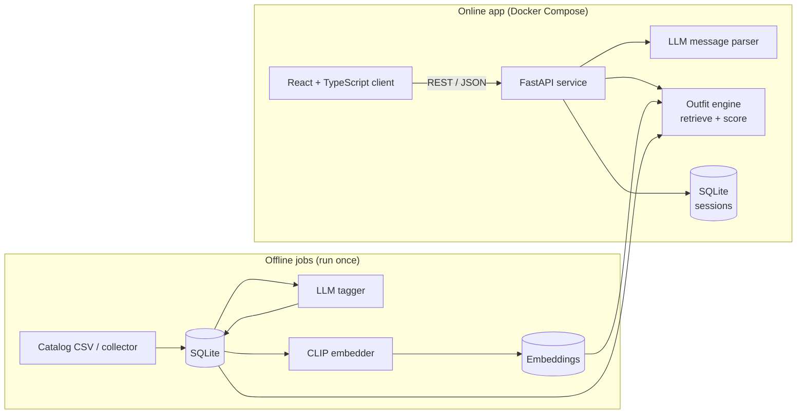

# AI Outfit Stylist: Technical Specification

| | |
|---|---|
| **Date** | October 20, 2026 |
| **Status** | Draft v3 |
| **Companion doc** | [Product Requirements](PRD.md) |

This document defines the tech stack and how the pieces fit together. The *what* and *why* of the product live in the [PRD](PRD.md), and implementation details live in the code.

---

## 1. Architecture at a Glance



- **Offline:** load the catalog, tag each item with an LLM, and compute CLIP embeddings. These steps are slow but only run once.
- **Online:** the client sends chat messages and button clicks to the API. The API parses the message, updates the session, builds the best-scoring outfit, and returns it.

---

## 2. Tech Stack

### Backend

| Layer | Choice | Why |
|---|---|---|
| Language | **Python 3.11** | The ML libraries are Python-first. |
| Web framework | **FastAPI** + Uvicorn | Typed REST endpoints, automatic OpenAPI docs at `/docs`, and a built-in test client. |
| Data validation | **Pydantic v2** | One set of models for API payloads, LLM outputs, and internal types. |
| Database | **SQLite** via **SQLAlchemy 2.0** | Real SQL with no server to run. Moving to Postgres only means changing the connection URL. |
| Config | **pydantic-settings** + `.env` | API keys and settings come from environment variables and are never committed. |

### ML / AI

| Layer | Choice | Why |
|---|---|---|
| Image + text embeddings | **open_clip** (ViT-B/32, CPU) | One model embeds both images and text in a shared space, which powers search and "more like this." |
| Vector search | **NumPy** | With about 100 items, plain cosine similarity is instant, so a vector database isn't needed. |
| LLM | **Claude** via the Anthropic Python SDK (Haiku for chat parsing, Sonnet for batch tagging) | Reliable structured output through tool use. The models are configurable. |
| Fuzzy name matching | **rapidfuzz** | Matches typed product names despite typos and missing words. |

### Frontend

| Layer | Choice | Why |
|---|---|---|
| Framework | **React 18 + TypeScript** | The most common frontend stack in internship postings. |
| Build tool | **Vite** | Fast dev server and simple setup. |
| Styling | **CSS Modules** | No UI library to learn in a 3.5-day build. |

### Testing & Quality

| Layer | Choice | Why |
|---|---|---|
| Tests | **pytest** + pytest-cov | Unit tests for the outfit engine, and API integration tests through FastAPI's test client. |
| Lint / format | **ruff** | One fast tool for both linting and formatting. |
| Type checking | **mypy** (Python), **tsc** (TypeScript) | Catch type errors in CI, before they reach runtime. |
| Test doubles | Fake LLM and fake embedder | Tests run offline, with no API key and no model download. |

### DevOps & Workflow

| Layer | Choice | Why |
|---|---|---|
| Python packaging | **uv** + `pyproject.toml` | Fast installs from a lockfile. |
| JS packaging | **npm** | Standard. |
| Containers | **Docker** + **Docker Compose** | `docker compose up` runs the whole app. |
| CI | **GitHub Actions** | Lint, type checks, tests, and the frontend build run on every pull request. |
| Version control | **Git + GitHub** | Feature branches, small PRs, a protected `main`, and Conventional Commits. |
| Project tracking | **GitHub Projects** | One issue per requirement, organized into day-sized milestones. |

---

## 3. Key Design Decisions

| Decision | Reason |
|---|---|
| Expensive work (tagging, image embeddings) runs offline. | Keeps each chat turn fast on a laptop CPU. |
| Outfit logic is pure Python with no I/O. | It is easy to unit-test and doesn't depend on the LLM. |
| Buttons skip the LLM, while chat goes through it. Both end in the same feedback function. | Button clicks are instant, and chat and buttons always behave the same way. |
| The LLM and CLIP sit behind interfaces with fake versions. | CI is fast and offline, and either model can be swapped out. |
| If the LLM fails or there is no API key, the app falls back to keyword rules. | The demo never crashes. |
| NumPy instead of FAISS, and SQLite instead of Postgres. | They are the right size for about 100 items, with an easy upgrade path. |

---

## 4. Repository Layout

```text
AritziasVeryOwn/
├── docs/                    # PRD.md, TECH_SPEC.md
├── backend/                 # FastAPI backend (Python)
│   ├── src/stylist/
│   │   ├── core/            # outfit engine: scoring, feedback, name matching
│   │   ├── adapters/        # Claude, CLIP, and database wrappers
│   │   ├── api/             # REST routes
│   │   └── jobs/            # offline jobs: ingest, tag, embed
│   └── tests/
├── web/                     # React + TypeScript client
├── data/                    # catalog CSV (committed); database and embeddings (gitignored)
├── eval/                    # gold labels, test sets, evaluation reports
├── docker-compose.yml
└── .github/workflows/ci.yml
```
