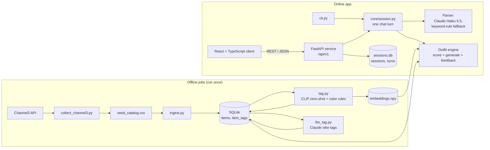

# AI Outfit Stylist: Technical Specification

| | |
|---|---|
| **Date** | October 20, 2026 |
| **Last updated** | October 29, 2026 (v6: Day 3 complete, with the LLM parser, LLM vibe tagging, and Docker) |
| **Status** | v6 |
| **Companion doc** | [Product Requirements](PRD.md) |

This document defines the tech stack and how the pieces fit together. The *what* and *why* of the product live in the [PRD](PRD.md), and implementation details live in the code.

---

## 1. Architecture at a Glance



- **Offline:** collect the catalog from Channel3, load it into SQLite, then tag every item with CLIP and save its photo embedding. These steps are slow but only run once.
- **Online:** a message goes to `core/session.py`. It parses the message into a request or a feedback action, updates the session, builds the best-scoring outfit, and returns it with a score breakdown. The CLI calls it directly, and the API calls the same functions.

---

## 2. Tech Stack

### Backend

| Layer | Choice | Why |
|---|---|---|
| Language | **Python 3.11+** (CI runs 3.11 and 3.13) | The ML libraries are Python-first. |
| Web framework | **FastAPI** + Uvicorn | Typed REST endpoints, automatic OpenAPI docs at `/docs`, and a built-in test client. |
| Data validation | **Pydantic v2** | One set of models for API payloads, LLM outputs, and internal types (`ParsedRequest`, `FeedbackIntent`, `SessionState`). |
| Database | **SQLite** via **SQLAlchemy 2.1** | Real SQL with no server to run. Moving to Postgres only means changing the connection URL. |
| Config | **python-dotenv** + `.env` | API keys come from environment variables and are never committed. |
| Catalog source | **Channel3** product API (`channel3-sdk`) | Structured product data with photos, without scraping the site. |

### ML / AI

| Layer | Choice | Why |
|---|---|---|
| Tagging | **open_clip** ViT-B/32 zero-shot (season, formality, and a fallback vibe) + rules over alt text and hex (color) | No API key or per-item cost. Each label is scored against several prompt phrasings. |
| Vibe tagging | **Claude Haiku 5.5** with each item's photo (512 px) and details, through structured outputs | CLIP misses the vibe target; the LLM scores 63% vs. CLIP's 43% on the gold set, for about $0.05 per catalog run. Answers are cached in the committed `data/llm_vibes.json`. |
| Image + text embeddings | **open_clip** (ViT-B/32, CPU) | One model embeds photos and request text in a shared space, which powers query relevance (and "more like this," P1). |
| Vector search | **NumPy** | With about 400 items, plain cosine similarity is instant, so a vector database isn't needed. |
| LLM | **Claude Haiku 5.5** via the Anthropic Python SDK, for chat parsing | Structured outputs constrain the reply to the parser's schema, and a turn costs about $0.0003. The model is configurable (`CLAUDE_MODEL`). |
| LLM, for comparison | Any **OpenAI-compatible** server through the `openai` SDK: Groq's free tier (gpt-oss-120b) or a local Ollama model | Used by the parser benchmark and for offline development. Not used for the live site. |
| Fuzzy name matching | **rapidfuzz** | Word-by-word matching tolerates typos, plurals, and missing words. |

### Frontend

| Layer | Choice | Why |
|---|---|---|
| Framework | **React 18 + TypeScript** | The most common frontend stack in internship postings. |
| Build tool | **Vite** | Fast dev server and simple setup. |
| Styling | **CSS Modules** | No UI library to learn in a 3.5-day build. |

### Testing & Quality

| Layer | Choice | Why |
|---|---|---|
| Tests | **pytest** | Unit tests for the engine and jobs; API integration tests through FastAPI's test client. |
| Test doubles | Fake CLIP model, fake embedder, small hand-built catalogs (`tests/factories.py`) | Tests run offline, with no API key, no PyTorch, and no model download. |
| Lint / types | None in CI, by choice | Tooling is kept minimal; `tsc` will type-check the client. |

### DevOps & Workflow

| Layer | Choice | Why |
|---|---|---|
| Python packaging | `requirements.txt` (exact pins) + `requirements-ml.txt` (PyTorch, CPU wheels) | Plain pip. PyTorch stays out of CI and the core install. |
| JS packaging | **npm** | Standard. |
| Containers | **Docker** + **Docker Compose** | `docker compose up` runs the API (Python slim image, no PyTorch) and the client (built with Node, served by nginx, which also proxies `/api`). |
| CI | **GitHub Actions** | On every PR and push to `main`, on Python 3.11 and 3.13: pytest, then a smoke test that runs `ingest.py`, `cli.py --demo --no-clip`, and `names_report.py` as scripts. |
| Version control | **Git + GitHub** | Feature branches, small PRs, a protected `main`, and Conventional Commits. |
| Project tracking | **GitHub Projects** | One issue per requirement, organized into day-sized milestones. |

---

## 3. Key Design Decisions

| Decision | Reason |
|---|---|
| Expensive work (tagging, image embeddings) runs offline. | Keeps each chat turn fast on a laptop CPU (about 80 ms to generate an outfit). |
| Season, formality, and color come from CLIP and rules; vibe comes from an LLM, falling back to CLIP for any item it hasn't tagged. | CLIP meets the season and formality targets for free but misses vibe (43%); Haiku reaches 63% (FR-TAG-5). The LLM's answers are committed, so rebuilding the database needs no API key. |
| Outfit logic in `core/` is pure Python with no I/O. | It is easy to unit-test and doesn't depend on the LLM, CLIP, or the database. `adapters/` does the loading. |
| Listings are grouped into products by a cleaned-up name (`core.catalog.product_key`). | Channel3 lists colorways and renamed copies separately (403 listings, 344 products). Grouping stops an outfit showing one product twice, and makes reject cover every colorway. |
| The generator shortlists the top 6 products per slot, then scores every valid combination. | About 12,000 combinations is small enough to search exhaustively, so there's no beam search to tune. |
| Score terms the request doesn't mention are left out, and the weights rebalance. | A vague request ("something nice") is scored on what it does say, not penalized for what it doesn't. |
| CLIP relevance is rescaled over the whole slot, not the shortlist. | Rejecting or swapping a piece can't inflate the next outfit's score. |
| Buttons and chat both become a `FeedbackIntent` and go through `apply_feedback`. | Chat and buttons always behave the same way (FR-FB-7). Buttons skip the parser. |
| `core/session.py` takes the parser and the text embedder as arguments. | The same turn logic runs with keyword rules or the LLM, and with real CLIP or a test fake. |
| The API is built by `create_app(catalog, embed, store, parse)`. | Tests pass a small catalog, a fake embedder, and a temporary database; `uvicorn --factory` passes nothing and gets the real ones. |
| A chat message that doesn't fit the outfit ("keep the dress" with no dress) is a 200 with a note; the same thing as a button click is a 409. | Typed messages are conversation, so the reply explains. A button that targets a missing piece is a client bug, so it's an error (FR-API-2). |
| Sessions and turns live in `data/sessions.db`, apart from `catalog.db`. | Re-running ingest can't touch them. Each turn row stores the parsed intent, outfit, locks, rejects, score, and latency, so G2 can be checked by scanning it. |
| The LLM fills in its own small schema (`LLMParse`), which code turns into `ParsedRequest` or `FeedbackIntent`. | The core validators still run (a swap needs a slot), and the message text and item IDs never come from the LLM. |
| Invalid LLM output is retried once with the validation error; then, and on any API error, refusal, or timeout, the message goes to keyword rules (`core/keyword_parser.py`). No key means keyword rules from the start. | A chat turn never fails because of the LLM (FR-REQ-2), and tests and CI need no key. The SDK's own retries are off, so a failing call falls back within the 4 s chat budget (NFR-1). |
| Chat messages are limited per client IP (20 a minute by default); buttons are not. | The site is public, and only chat makes an LLM call, so this caps what one script can spend. |
| Evaluation sets are labeled before results are seen, and any reuse is disclosed. | The gold set was labeled before tagging ran. The G4 queries were used once while improving the resolver, so the report prints the pre-tuning baseline next to every result. |
| Both tag snapshots are committed (`data/clip_tags.json`, `data/llm_vibes.json`), and `jobs/restore_tags.py` loads the CLIP one. | A fresh clone, CI, and the Docker image get the same tags as a full run, with no PyTorch, photo downloads, or API key. `tag.py` rewrites the snapshot after each full run. |
| The Docker image leaves out PyTorch, and nginx serves the client and proxies `/api`. | The image stays small enough for cheap hosting (CLIP would add over 1 GB), and one origin means no CORS setup. nginx overwrites `X-Forwarded-For`, so the per-IP chat limit sees the real client and can't be dodged with a forged header. |
| NumPy instead of FAISS, and SQLite instead of Postgres. | They are the right size for about 400 items, with an easy upgrade path. |

---

## 4. Repository Layout

```text
AritziasVeryOwn/
├── docs/                      # PRD.md, TECH_SPEC.md, plans/
├── backend/
│   ├── src/stylist/
│   │   ├── core/              # outfit engine, pure Python: models, catalog (product grouping),
│   │   │                      #   scoring, generator, feedback, names, keyword_parser, session
│   │   ├── adapters/          # catalog_store (SQLite + embeddings -> Catalog), clip_text (query
│   │   │                      #   embeddings), session_store (sessions.db), llm_parser (Claude, OpenAI-compatible)
│   │   ├── tagging/           # clip_tagger.py (zero-shot), colors.py (alt-text and hex rules)
│   │   ├── jobs/              # offline jobs: collect_channel3, ingest, tag, llm_tag, tagging_report,
│   │   │                      #   names_report, parser_report
│   │   ├── api/               # app.py (FastAPI routes, error handlers), schemas.py (request/response bodies)
│   │   └── cli.py             # terminal chat; --demo plays Flows A–D
│   └── tests/
├── web/                       # React + TypeScript client (Vite)
├── data/                      # committed: seed_catalog.csv, clip_tags.json, llm_vibes.json;
│                              #   gitignored: catalog.db, sessions.db, images/, embeddings
├── eval/                      # gold_set.csv + gold_labeling.md, tagging_report.md, names_test.csv,
│                              #   parser_test.csv, parser_report.md
├── requirements.txt           # core + tests (what CI installs)
├── requirements-ml.txt        # adds PyTorch + open_clip for tagging and the CLI's query embeddings
├── docker-compose.yml         # api (backend/Dockerfile) + web (web/Dockerfile, nginx.conf)
└── .github/workflows/ci.yml
```
